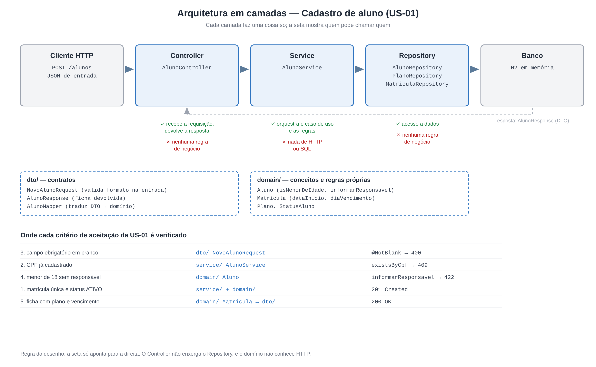

# Sistema de Gestão para Academia — Backlog

Prática guiada da disciplina de **Engenharia de Software** — Uniube
Prof. Me. Clênio Silva

## Objetivo

Transformar um problema simples de um domínio real em um **backlog rastreável no GitHub**,
com perfis de usuário, User Stories, critérios de aceitação, Issues rotuladas e priorizadas,
organizadas em um GitHub Project com colunas de andamento.

## Domínio escolhido: Academia

Uma academia de bairro com ~600 alunos ativos, três instrutores por turno, uma recepção e
um gerente/proprietário. Hoje o controle é feito em planilhas e em uma agenda de papel:
a ficha de treino é impressa, o check-in é anotado à mão, a cobrança de mensalidade é
conferida manualmente e não existe visão de frequência ou de inadimplência.

O sistema proposto cobre seis módulos:

| Módulo | O que resolve |
| --- | --- |
| Cadastro | Alunos, planos e dados contratuais |
| Acesso | Check-in na entrada e bloqueio de inadimplentes |
| Treino | Fichas de treino, execução e histórico |
| Avaliação | Avaliações físicas periódicas e evolução |
| Financeiro | Mensalidades, renovação e pagamentos |
| Agendamento | Aulas coletivas com vagas limitadas |
| Relatórios | Frequência, ocupação por horário e inadimplência |

## Estrutura da entrega

| Arquivo | Conteúdo |
| --- | --- |
| [`docs/personas.md`](docs/personas.md) | Os 4 perfis de usuário |
| [`docs/user-stories.md`](docs/user-stories.md) | As 10 User Stories com critérios de aceitação |
| [`docs/backlog.md`](docs/backlog.md) | Matriz de rastreabilidade: US ↔ Issue ↔ label ↔ prioridade |
| [`docs/project-setup.md`](docs/project-setup.md) | Como o GitHub Project está organizado |
| [`docs/uml/`](docs/uml) | Diagramas de casos de uso e de classes (SVG + PNG + PDF) e a modelagem |
| [`academia-api/`](academia-api) | Implementação em camadas da US-01 (Spring Boot) |
| [`docs/issues/`](docs/issues) | Corpo de cada Issue, pronto para publicação |
| [`scripts/criar-issues.sh`](scripts/criar-issues.sh) | Recria labels e Issues em outro repositório, via GitHub CLI |
| [`scripts/aplicar-cores-labels.sh`](scripts/aplicar-cores-labels.sh) | Padroniza as cores das labels |
| [Issues](../../issues) | Uma Issue por User Story, com labels e prioridade |

## Rastreabilidade

Cada User Story tem um identificador estável (`US-01` … `US-10`) que aparece:

1. no título da Issue — `[US-01] Como recepcionista, quero cadastrar um novo aluno...`;
2. na matriz de `docs/backlog.md`, ligando a história à Issue e ao módulo;
3. nos diagramas UML de `docs/uml/`, que mapeiam cada história ao seu caso de uso;
4. nas mensagens de commit e nos Pull Requests que implementarem a história,
   no formato `US-01: descrição` + `Closes #N`.

Assim é possível partir de qualquer commit e chegar à história que o originou — e vice-versa.

## Convenções de labels

| Categoria | Labels |
| --- | --- |
| Tipo | `user-story` |
| Prioridade | `prioridade: alta`, `prioridade: média`, `prioridade: baixa` |
| Perfil | `perfil: aluno`, `perfil: instrutor`, `perfil: recepção`, `perfil: gerente` |
| Módulo | `módulo: cadastro`, `módulo: acesso`, `módulo: treino`, `módulo: avaliação`, `módulo: financeiro`, `módulo: agendamento`, `módulo: relatórios` |

A prioridade segue MoSCoW: `alta` = *Must have* (sem isso a academia não opera),
`média` = *Should have* (entra na segunda entrega), `baixa` = *Could have*.

## Situação da entrega

| Item | Situação |
| --- | --- |
| Domínio definido | ✅ Academia |
| Perfis de usuário | ✅ 4 perfis |
| User Stories | ✅ 10 histórias (mínimo era 8) |
| Critérios de aceitação | ✅ 43 critérios, no mínimo 4 por história |
| Issues com labels e prioridade | ✅ [#1 a #10](../../issues) |
| GitHub Project | ver [`docs/project-setup.md`](docs/project-setup.md) |
| Diagrama de casos de uso | ✅ [PNG](docs/uml/casos-de-uso.png) · [SVG](docs/uml/casos-de-uso.svg) |
| Diagrama de classes | ✅ [PNG](docs/uml/classes.png) · [SVG](docs/uml/classes.svg) |
| PDF da entrega (os dois diagramas) | ✅ [`docs/uml/diagramas-uml.pdf`](docs/uml/diagramas-uml.pdf) |
| Implementação em camadas (US-01) | ✅ [`academia-api/`](academia-api) — 8 testes passando |

## Arquitetura da implementação

A US-01 (cadastro de aluno) está implementada em `academia-api/`, separada em camadas:



```
Cliente HTTP  →  Controller  →  Service  →  Repository  →  Banco (H2)
                     ↑                                        │
                     └──────────  AlunoResponse (DTO)  ───────┘
```

| Camada | Responsabilidade | Evitar |
| --- | --- | --- |
| `controller/` | Receber a requisição e devolver a resposta | Regra de negócio |
| `service/` | Orquestrar o caso de uso e as regras | Detalhes de HTTP/SQL |
| `domain/` | Representar conceitos e regras próprias do objeto | Conhecer a UI |
| `repository/` | Acesso a dados | Regra de negócio |

Cada critério de aceitação da história foi para a camada que lhe cabe — formato no DTO,
unicidade de CPF no service, regra de menoridade no domínio. O detalhamento está em
[`academia-api/README.md`](academia-api/README.md).
