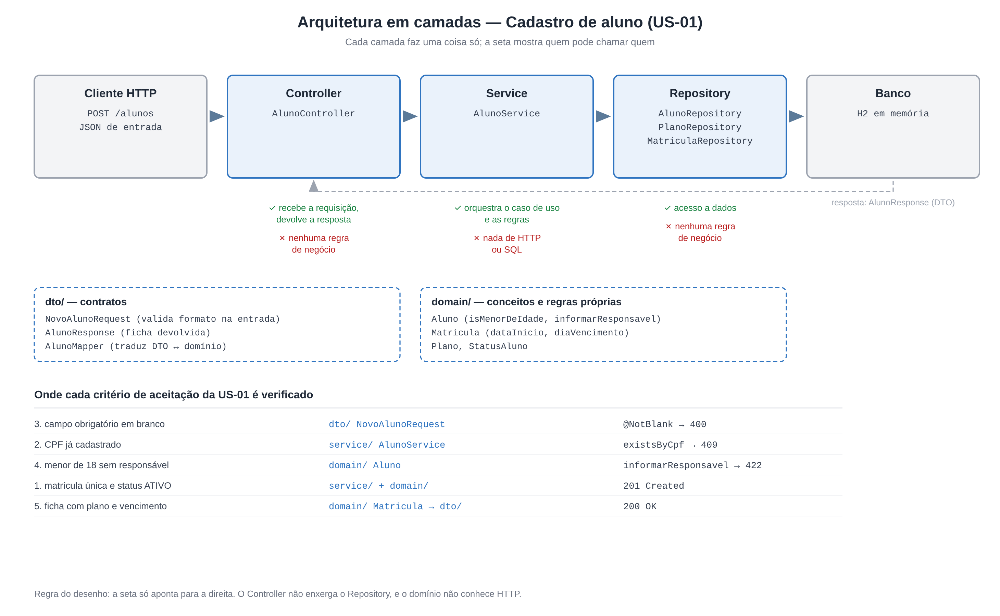

# academia-api — cadastro de aluno em camadas

Prática guiada da Aula 9 (Arquitetura em Camadas e MVC) — Engenharia de Software, Uniube.

**Objetivo:** organizar uma funcionalidade do backlog separando responsabilidades, sem
regra de negócio no Controller.

**User Story implementada:** [US-01 — Cadastro de aluno com plano](https://github.com/kauaMatheusRa/EngenhariaSoftware-Uniube/issues/1).
Foi a escolhida por ser a de maior prioridade do backlog e por ter cinco critérios de
aceitação de naturezas diferentes — formato, unicidade, regra de idade, geração de dado e
composição de resposta —, o que obriga a distribuir a lógica entre as camadas em vez de
empilhar tudo em um lugar só.

---

## Diagrama da arquitetura



```
Cliente HTTP  →  Controller  →  Service  →  Repository  →  Banco (H2)
                     ↑                                        │
                     └──────────  AlunoResponse (DTO)  ───────┘
```

A seta só aponta para a direita: o Controller não enxerga o Repository e o domínio não
conhece HTTP.

| Camada | Faz | Não faz |
| --- | --- | --- |
| `controller/` | Recebe a requisição e devolve a resposta | Regra de negócio, acesso a banco |
| `service/` | Orquestra o caso de uso e as regras que dependem de outros dados | Detalhes de HTTP ou SQL |
| `domain/` | Representa os conceitos e aplica as regras próprias de cada objeto | Conhecer a UI ou o banco |
| `repository/` | Acesso a dados | Regra de negócio |
| `dto/` | Contratos de entrada e saída, e a tradução para o domínio | Guardar estado do sistema |
| `exception/` | Erros de negócio e sua tradução para HTTP | Decidir a regra em si |

---

## Onde cada critério de aceitação da US-01 foi parar

Essa é a parte que importa na prática: a mesma funcionalidade, com cada regra na camada
que lhe cabe.

| Critério da US-01 | Onde vive | Resultado |
| --- | --- | --- |
| 3 — campo obrigatório em branco | `dto/NovoAlunoRequest` (`@NotBlank`, `@Pattern`) | `400` com a lista de campos |
| 2 — CPF já cadastrado | `service/AlunoService` (precisa consultar o repositório) | `409` |
| 4 — menor de 18 sem responsável | `domain/Aluno.informarResponsavel()` (depende só do próprio aluno) | `422` |
| 1 — matrícula única e status `ATIVO` | `service/` gera a matrícula, `domain/Aluno` nasce `ATIVO` | `201` |
| 5 — ficha com plano, valor e vencimento | `domain/Matricula` → `dto/AlunoResponse` | `200` |

O critério de decisão foi simples: **regra que depende só do próprio objeto fica no
domínio; regra que precisa consultar outros dados fica no service; formato de entrada fica
no DTO.** O Controller não decide nada.

---

## Estrutura de pastas

```
src/main/java/br/uniube/academia/
├── AcademiaApiApplication.java
├── controller/   AlunoController
├── service/      AlunoService
├── domain/       Aluno · Matricula · Plano · StatusAluno
├── repository/   AlunoRepository · PlanoRepository · MatriculaRepository
├── dto/          NovoAlunoRequest · AlunoResponse · AlunoMapper
└── exception/    CpfDuplicadoException · ResponsavelObrigatorioException
                  PlanoNaoEncontradoException · AlunoNaoEncontradoException
                  ApiExceptionHandler · ErroResposta
```

---

## Como rodar

Requisitos: **JDK 21** e Maven.

```bash
cd academia-api
mvn test          # 8 testes
mvn spring-boot:run
```

A aplicação sobe em `http://localhost:8080` com banco H2 em memória, já com três planos
cadastrados (Mensal, Trimestral, Anual). Console do banco em `/h2-console`.

## Endpoints

| Método | Rota | O que faz |
| --- | --- | --- |
| `POST` | `/alunos` | Cadastra o aluno e cria a matrícula no plano |
| `GET` | `/alunos/{id}` | Devolve a ficha do aluno |

### Exemplos verificados

Cadastro válido:

```bash
curl -X POST http://localhost:8080/alunos -H 'Content-Type: application/json' \
  -d '{"nome":"Marina Souza","cpf":"12345678901","dataNascimento":"1999-03-14",
       "telefone":"34999990000","planoId":1}'
```

```json
HTTP 201
{"id":1,"matricula":"202600001","nome":"Marina Souza","cpf":"12345678901",
 "status":"ATIVO","dataInicio":"2026-11-22","plano":"Mensal",
 "valorMensalidade":119.90,"diaVencimento":22}
```

CPF repetido (critério 2):

```json
HTTP 409
{"status":409,"erro":"CPF duplicado",
 "mensagem":"CPF 12345678901 ja cadastrado para outro aluno"}
```

Nome em branco (critério 3):

```json
HTTP 400
{"status":400,"erro":"Campos invalidos",
 "campos":[{"campo":"nome","mensagem":"nome e obrigatorio"}]}
```

Menor de 18 sem responsável (critério 4):

```json
HTTP 422
{"status":422,"erro":"Responsavel obrigatorio",
 "mensagem":"Aluno Pedro Lima e menor de 18 anos: informe nome e CPF do responsavel"}
```

---

## Testes

```
AlunoTest ..................... 9  regra de idade no dominio, sem mock e sem Spring
AlunoServiceTest .............. 11 caminho feliz, fronteiras e erros (Clock fixo)
AlunoControllerTest ...........  3 contrato HTTP, com o service mockado
AcademiaApiApplicationTests ...  1 as camadas se conectam de verdade
                                24 testes, 0 falhas
```

```bash
cd academia-api && mvn test
```

Os cenarios foram listados **antes** de escrever qualquer teste, em
[`docs/cenarios-de-teste.md`](../docs/cenarios-de-teste.md), e cada teste segue
Arrange-Act-Assert explicito.

### Dois testes que protegem a arquitetura

`AlunoControllerTest` verifica com `verify(service, never())` que entrada invalida **nao
chega ao service**. `AlunoServiceTest.cpfDuplicado` verifica que, com CPF repetido, nem o
plano chega a ser consultado. Se alguem mover a validacao de camada, os testes quebram.

### Uma refatoracao que veio dos testes

Os cenarios de fronteira ("faz 18 anos exatamente hoje", "faz 18 anos amanha") nao eram
testaveis de forma repetivel: `Aluno.isMenorDeIdade()` lia `LocalDate.now()` por dentro, e
o resultado dependeria do dia em que a suite rodasse.

| Antes | Depois |
| --- | --- |
| `isMenorDeIdade()` | `isMenorDeIdade(LocalDate hoje)` |
| `AlunoService` chamava `LocalDate.now()` | recebe um `java.time.Clock` injetado |

Em producao o Spring injeta `Clock.systemDefaultZone()` e o comportamento e identico; no
teste, um `Clock.fixed` deixa as datas sob controle. O dominio tambem deixou de depender do
relogio do sistema, que e um recurso externo como banco ou rede.
