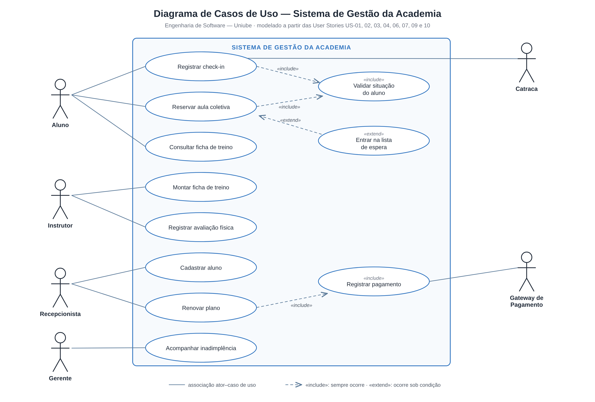
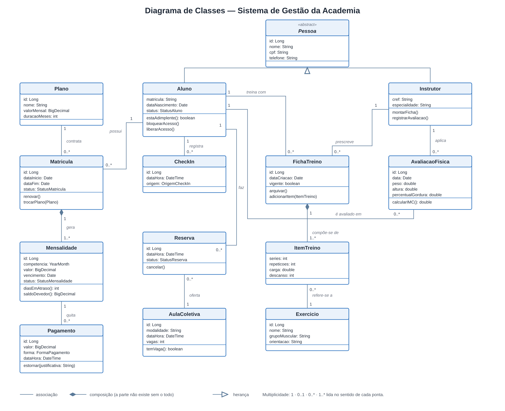

# UML do projeto — Casos de Uso e Classes

Prática guiada da Aula 5 (UML prática) — Engenharia de Software, Uniube.
**Objetivo:** modelar o comportamento externo e a estrutura essencial do sistema da academia,
partindo do backlog já construído.

Os diagramas são versionados em três formatos: `.svg` (fonte vetorial, editável), `.png`
(visualização no GitHub e em apresentação) e um PDF único de duas páginas,
[`diagramas-uml.pdf`](diagramas-uml.pdf) (A4 paisagem), que é o arquivo da entrega.

---

## 1. User Stories escolhidas

Das 10 histórias do backlog, foram modeladas 8 — as que cobrem os quatro perfis de usuário e
os cinco módulos centrais do sistema:

| História | Resumo | Perfil | Issue |
| --- | --- | --- | --- |
| US-01 | Cadastro de aluno com plano | Recepcionista | [#1](https://github.com/kauaMatheusRa/EngenhariaSoftware-Uniube/issues/1) |
| US-02 | Check-in na entrada | Aluno | [#2](https://github.com/kauaMatheusRa/EngenhariaSoftware-Uniube/issues/2) |
| US-03 | Montagem da ficha de treino | Instrutor | [#3](https://github.com/kauaMatheusRa/EngenhariaSoftware-Uniube/issues/3) |
| US-04 | Consulta da ficha no app | Aluno | [#4](https://github.com/kauaMatheusRa/EngenhariaSoftware-Uniube/issues/4) |
| US-06 | Avaliação física periódica | Instrutor | [#6](https://github.com/kauaMatheusRa/EngenhariaSoftware-Uniube/issues/6) |
| US-07 | Renovação de plano e pagamento | Recepcionista | [#7](https://github.com/kauaMatheusRa/EngenhariaSoftware-Uniube/issues/7) |
| US-09 | Inadimplência e bloqueio de acesso | Gerente | [#9](https://github.com/kauaMatheusRa/EngenhariaSoftware-Uniube/issues/9) |
| US-10 | Agendamento de aula coletiva | Aluno | [#10](https://github.com/kauaMatheusRa/EngenhariaSoftware-Uniube/issues/10) |

Ficaram de fora **US-05** (registro de execução do treino) e **US-08** (relatório de ocupação):
ambas são variações de comportamento já representado — US-05 opera sobre a mesma ficha de
US-04, e US-08 lê os check-ins de US-02. Incluí-las engordaria o diagrama sem acrescentar
informação, contrariando o critério de diagrama enxuto.

---

## 2. Atores e casos de uso

### Atores

| Ator | Tipo | Por que é ator |
| --- | --- | --- |
| **Aluno** | primário | Inicia check-in, consulta treino e reserva aula |
| **Instrutor** | primário | Prescreve treino e registra avaliação física |
| **Recepcionista** | primário | Opera cadastro, renovação e pagamento no balcão |
| **Gerente** | primário | Acompanha inadimplência e decide sobre cobrança |
| **Catraca** | secundário | Dispositivo externo que recebe a ordem de liberar ou barrar o acesso |
| **Gateway de Pagamento** | secundário | Sistema externo que confirma a transação |

Catraca e Gateway entram porque há **integração relevante**: o sistema depende da resposta
deles para concluir o caso de uso. Já o "app do aluno" e a "tela da recepção" **não** são
atores — são interfaces do próprio sistema, e transformá-las em atores seria confundir canal
com papel.

### Mapa história → caso de uso

| História | Caso de uso | Ator primário |
| --- | --- | --- |
| US-01 | Cadastrar aluno | Recepcionista |
| US-02 | Registrar check-in | Aluno |
| US-03 | Montar ficha de treino | Instrutor |
| US-04 | Consultar ficha de treino | Aluno |
| US-06 | Registrar avaliação física | Instrutor |
| US-07 | Renovar plano | Recepcionista |
| US-09 | Acompanhar inadimplência | Gerente |
| US-10 | Reservar aula coletiva | Aluno |

---

## 3. Diagrama de casos de uso

Arquivos: [`casos-de-uso.png`](casos-de-uso.png) · [`casos-de-uso.svg`](casos-de-uso.svg) · página 1 de [`diagramas-uml.pdf`](diagramas-uml.pdf)

### Os relacionamentos, e por que cada um

| Relacionamento | Entre | Justificativa |
| --- | --- | --- |
| `«include»` | Registrar check-in → Validar situação do aluno | Toda entrada passa pela verificação de plano e adimplência (US-02, critérios 1 e 2) |
| `«include»` | Reservar aula coletiva → Validar situação do aluno | A reserva é recusada para aluno bloqueado (US-10, critério 5) — é o mesmo comportamento, reutilizado |
| `«include»` | Renovar plano → Registrar pagamento | A renovação só se conclui com o pagamento lançado (US-07, critério 2) |
| `«extend»` | Entrar na lista de espera → Reservar aula coletiva | Só acontece **se** a turma estiver lotada (US-10, critério 2) — condicional, não obrigatório |

A regra que separa os dois: `«include»` é comportamento que **sempre** ocorre e foi extraído
para não ser descrito duas vezes; `«extend»` é comportamento que ocorre **sob condição**, e o
caso de uso base continua completo sem ele.

---

## 4. Do domínio para as classes

### Substantivos levantados nas histórias

> aluno · plano · matrícula · mensalidade · pagamento · vencimento · catraca · QR Code ·
> check-in · ficha de treino · exercício · série · repetição · carga · instrutor · avaliação
> física · IMC · aula coletiva · vaga · reserva · lista de espera · painel · relatório ·
> recepcionista · gerente · app

### O filtro

Nem todo substantivo vira classe. O que foi descartado e por quê:

| Descartado | Motivo |
| --- | --- |
| QR Code, catraca, app, tela | Canal ou dispositivo, não conceito do domínio (a catraca é **ator**) |
| painel, relatório | Visões sobre dados que já existem — não guardam estado próprio |
| IMC | Valor derivado de peso e altura: vira o método `calcularIMC()` |
| série, repetição, carga | Atributos de `ItemTreino`, não conceitos independentes |
| vencimento | Atributo de `Mensalidade` |
| recepcionista, gerente | Atuam sobre o sistema, mas não têm dados próprios no escopo modelado |
| lista de espera | Estado de `Reserva` (`StatusReserva`), não uma classe à parte |

### As 14 classes selecionadas

`Pessoa` (abstrata) · `Aluno` · `Instrutor` · `Plano` · `Matricula` · `Mensalidade` ·
`Pagamento` · `CheckIn` · `FichaTreino` · `ItemTreino` · `Exercicio` · `AvaliacaoFisica` ·
`AulaColetiva` · `Reserva`

`Pessoa` existe porque `Aluno` e `Instrutor` compartilham identificação (nome, CPF, telefone):
é **herança**, não repetição de atributos.

---

## 5. Diagrama de classes

Arquivos: [`classes.png`](classes.png) · [`classes.svg`](classes.svg) · página 2 de [`diagramas-uml.pdf`](diagramas-uml.pdf)

### Multiplicidades e o critério de aceitação que as justifica

| Relação | Multiplicidade | De onde vem |
| --- | --- | --- |
| Aluno — Matricula | 1 → 0..* | O aluno renova e troca de plano ao longo do tempo; o histórico é mantido (US-07, critério 1) |
| Matricula — Plano | 0..* → 1 | Cada matrícula vigora sobre exatamente um plano |
| Matricula ◆ Mensalidade | 1 → 1..* | **Composição**: mensalidade não existe fora de uma matrícula; toda matrícula gera ao menos uma |
| Mensalidade — Pagamento | 1 → 0..* | Vários pagamentos para a mesma mensalidade — é o que permite o **pagamento parcial** (US-07, critério 3) |
| Aluno — CheckIn | 1 → 0..* | Um registro por entrada (US-02, critério 1) |
| Aluno — FichaTreino | 1 → 0..* | Fichas anteriores são arquivadas, não apagadas; só uma fica vigente (US-03, critério 4) |
| Instrutor — FichaTreino | 1 → 0..* | A ficha fica vinculada a quem prescreveu (US-03, critério 1) |
| FichaTreino ◆ ItemTreino | 1 → 1..* | **Composição**, e o mínimo é 1 porque a ficha sem exercício é recusada (US-03, critério 3) |
| ItemTreino — Exercicio | 0..* → 1 | O mesmo exercício do catálogo reaparece em várias fichas |
| Aluno — AvaliacaoFisica | 1 → 0..* | Série histórica trimestral, usada na comparação (US-06, critério 2) |
| Instrutor — AvaliacaoFisica | 1 → 0..* | Toda avaliação tem um responsável |
| AulaColetiva — Reserva | 1 → 0..* | Limitado pelo número de vagas (US-10, critério 1) |
| Aluno — Reserva | 1 → 0..* | Histórico de reservas, usado na regra de faltas (US-10, critério 4) |

As duas **composições** (losango preenchido) marcam dependência de existência: apagada a
matrícula, somem suas mensalidades; apagada a ficha, somem seus itens. As demais relações são
associações simples, em que as duas pontas existem por conta própria.

---

## 6. Revisão — o diagrama explica o sistema?

Teste aplicado: percorrer cenários reais e verificar se os diagramas respondem sozinhos.

| Cenário | O diagrama responde? |
| --- | --- |
| "Aluno em atraso tenta entrar" | Sim — `Registrar check-in` `«include»` `Validar situação do aluno`, que lê `Mensalidade.diasEmAtraso()` e manda a `Catraca` barrar |
| "Aluno quer spinning, turma lotada" | Sim — `Reservar aula coletiva` com `«extend»` `Entrar na lista de espera`, condicionado por `AulaColetiva.temVaga()` |
| "Recepção recebe metade da mensalidade" | Sim — `Mensalidade 1 → 0..* Pagamento` e `saldoDevedor()` |
| "Instrutor revisa o treino de três meses atrás" | Sim — `Aluno 1 → 0..* FichaTreino`, com `vigente: boolean` separando a atual das arquivadas |
| "Quem prescreveu esta ficha?" | Sim — associação `Instrutor → FichaTreino` |

Pontos deliberadamente **fora** dos diagramas, por não serem estruturais: layout de telas,
tecnologia de persistência, formato do relatório e detalhes do protocolo com a catraca.

---

## Como os arquivos foram gerados

Os dois diagramas são SVG escritos à mão (sem ferramenta proprietária), o que os torna
versionáveis e revisáveis por diff no próprio repositório. O PNG é a rasterização do SVG em
escala 2×, para leitura em projetor. O PDF reúne os dois diagramas em duas páginas A4
paisagem, geradas dos mesmos SVGs: preserva o vetor, então dá para ampliar sem perder nitidez
e o texto continua selecionável.
